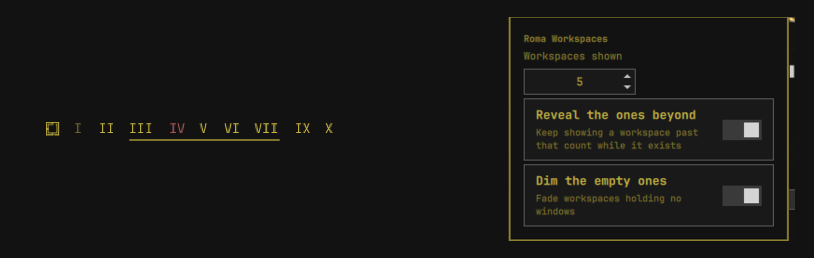

# Roma Workspaces

Workspace indicators for the Omarchy bar, in Roman numerals:

```
I  II  III  IV  V
```

The one you are on takes the theme's accent, empty ones are dimmed, and
hovering a numeral lists the windows on that workspace. Left click focuses
it. Right click opens a menu for how many there should be.

Companion to [Roma](https://github.com/SmartALB/omarchy-roma), which does
the same to the clock. Neither needs the other.

## Screenshot



## Configuration

**Right click a numeral** — left click is taken, it focuses the workspace.

| Setting | Does | Default |
|---|---|---|
| Workspaces shown | How many are always in the bar, from `I` upwards (1–20) | 5 |
| Reveal the ones beyond | Keeps a workspace past that count visible while it exists | on |
| Dim the empty ones | Fades workspaces holding no windows | on |

“Workspaces shown” is a floor, not a ceiling. With it at 5 and *Reveal the
ones beyond* on, moving to workspace 7 makes `VII` appear in the bar and
disappear again when the last window leaves it — so the workspace you are
actually on is never missing. Switch that off and the count is literal.

The same settings from the command line:

```bash
omarchy bar set smartalb.roma-workspaces workspaceCount 8 --json
omarchy bar set smartalb.roma-workspaces dimEmpty false --json
```

**Pass `--json`.** Without it the value is stored as a string rather than a
number or boolean. This widget reads both forms correctly, but the JSON form
is what the setting is meant to be, and other tools reading `shell.json`
will expect it.

## Install

```
omarchy plugin add https://github.com/SmartALB/omarchy-roma-workspaces.git --enable
```

It lands in `~/.config/omarchy/plugins/smartalb.roma-workspaces/`, named
after the plugin id rather than the repository. Leaving off `--enable`
installs it disabled so the code can be read first; enable it afterwards
with `omarchy plugin enable smartalb.roma-workspaces`. Either way, restart
the shell once so the QML is picked up:

```
omarchy-restart-shell
```

To use it *instead of* the stock indicators rather than beside them:

```
omarchy plugin disable omarchy.workspaces
```

## Removal

```
omarchy plugin remove smartalb.roma-workspaces
```

That takes the plugin directory and its entry in `shell.json`. Nothing else
is kept anywhere, so nothing else survives.

## What it is

A clone of the built-in `omarchy.workspaces` widget with the labels changed.
Everything that is not about numerals is the built-in behaviour: the grid
turns into a single column when the bar is vertical, focus goes through the
same `hl.dsp.focus` dispatch, and the buttons are the bar's own, so they
follow whatever theme is active. **No colour and no font is hardcoded** —
what you see is your theme, not this author's.

Numerals are computed in classical subtractive form (`IV`, not `IIII`)
rather than looked up in a table. The widget can show numeric workspaces from
`I` through `XX`; the default remains five.

Two things the built-in does not do: the numerals, and a tooltip listing the
window classes on each workspace, deduplicated and cut off after three.

## Tests

```bash
test/run-tests.sh
```

The suite checks the version and workspace-range contracts, then executes the
same Roman numeral and setting-coercion functions the widget imports. It uses
Node.js for those behavioural checks; Node.js is needed only for development,
not by the installed widget.

## Requires

At runtime, only Hyprland, which Omarchy runs anyway. No helper processes,
additional packages, or network access.

## License

MIT. See [LICENSE](LICENSE).
